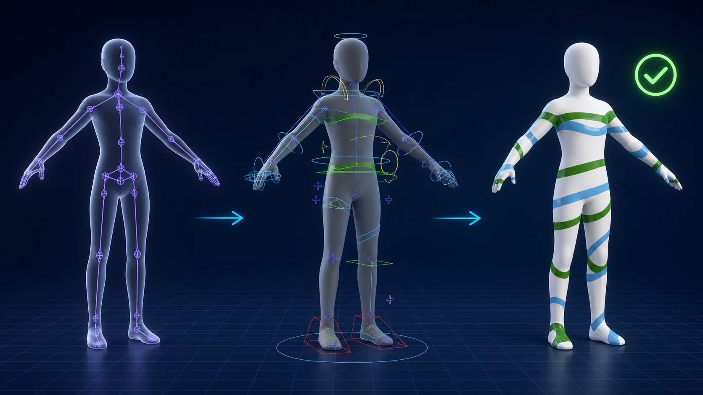

# dcc-mcp-maya-advancedskeleton

AdvancedSkeleton rigging skills for `dcc-mcp-maya`.

Illustrative workflow derived from the verified Cesium Man test case. Cesium Man is
copyright 2017 Cesium and is used under its model-specific license; see the
[case license](skill/maya-advancedskeleton/examples/CesiumMan_LICENSE.md).

## Capability coverage

| Requested workflow | Skill tools |
| --- | --- |
| Discover the installed body/limb FitSkeleton presets | `inspect_advancedskeleton` |
| Import and position a standard FitSkeleton | `import_fit_skeleton` |
| Build a custom modular skeleton from labels and attributes | `create_fit_skeleton`, `configure_fit_joint` |
| Configure twist/bendy, orientation, follow, and controller generation | `configure_fit_joint` |
| Build once, edit FitSkeleton, and reproduce the rig | `build_advancedskeleton` (Build/ReBuild) |

The workbook's Root -> Shoulder -> Elbow -> Hand-labelled Wrist acceptance case is runnable from [RECIPES.md](skill/maya-advancedskeleton/references/RECIPES.md).

## End-to-end Maya MCP case

This verified case combines `maya-advancedskeleton` with the Maya import,
rigging, animation, and playblast tools. This Skill owns FitSkeleton setup and
the AdvancedSkeleton build; the run/jump animation is downstream validation.

| FitSkeleton aligned to the character | Generated AdvancedSkeleton controls |
| --- | --- |
|  |  |

[Watch the 300-frame run/jump playblast](skill/maya-advancedskeleton/examples/cesium-man-run-jump-300f.mp4)
(H.264, 1280x720, 24 fps, 12.5 seconds, approximately 15 metres of travel).

Read [CASE_STUDY.md](skill/maya-advancedskeleton/references/CASE_STUDY.md)
for the workflow boundary, validation evidence, source, and license details.

## Requirements

- Maya 2020-2026
- `dcc-mcp-core >= 0.18`
- `dcc-mcp-maya`
- An installed and appropriately licensed AdvancedSkeleton 6.x package

Add `skill/maya-advancedskeleton` to the Maya adapter's skill paths, search for `maya-advancedskeleton`, load it, and call `inspect_advancedskeleton` before scene-changing tools.

## Safety

- No arbitrary MEL execution tool.
- Template names cannot escape AdvancedSkeleton's installed template directories.
- Joint, label, and AdvancedSkeleton attribute inputs are validated.
- Existing FitSkeleton replacement is opt-in and refused after a rig has been built.

## Licenses

This MCP integration is MIT licensed. AdvancedSkeleton is third-party software governed by its own EULA and commercial-use terms. This repository does not redistribute AdvancedSkeleton code, templates, example rigs, or documentation.
