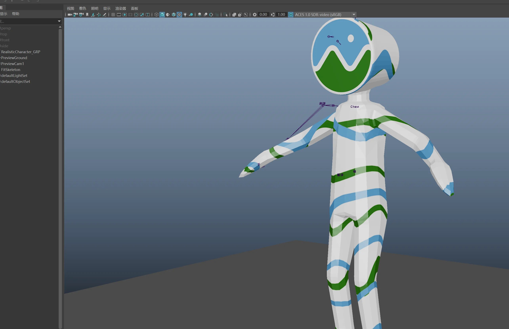
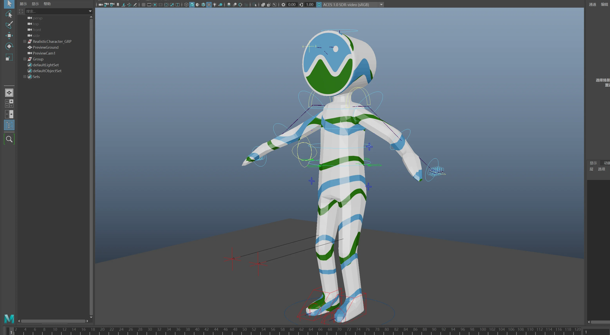

# Cesium Man binding and run/jump case

This case proves the Skill against a textured, human-proportioned character in
Maya 2022 with AdvancedSkeleton 6.600.0-thm.1.

## Workflow boundary

1. The marketplace `gltf-sample-assets` Skill downloads Cesium Man and its
   license metadata.
2. Maya import tools load the character mesh.
3. `maya-advancedskeleton` imports and adjusts the FitSkeleton, then builds the
   AdvancedSkeleton rig.
4. Maya rigging tools bind the mesh to 22 deformation joints.
5. Maya animation tools create the downstream 300-frame run/jump validation and
   playblast. Animation is not provided by `maya-advancedskeleton` itself.

## Evidence

| FitSkeleton alignment | Built AdvancedSkeleton rig |
| --- | --- |
|  |  |

[Watch the 300-frame playblast](../examples/cesium-man-run-jump-300f.mp4).

The playblast is H.264 at 1280x720 and 24 fps. It contains exactly 300 frames,
runs for 12.5 seconds, and covers approximately 15 metres with a hurdle jump.

## Asset source and license

- Source: [Khronos glTF Sample Assets — Cesium Man](https://github.com/KhronosGroup/glTF-Sample-Assets/tree/main/Models/CesiumMan)
- Credit: copyright 2017 Cesium
- Model license: `LicenseRef-CC-BY-TM`
- Logo terms: `LicenseRef-LegalMark-Cesium`
- Local copies: [license](../examples/CesiumMan_LICENSE.md) and
  [source metadata](../examples/CesiumMan_SOURCE.md)

AdvancedSkeleton is third-party software governed by its own EULA. No
AdvancedSkeleton code, templates, example rigs, or documentation are included.
